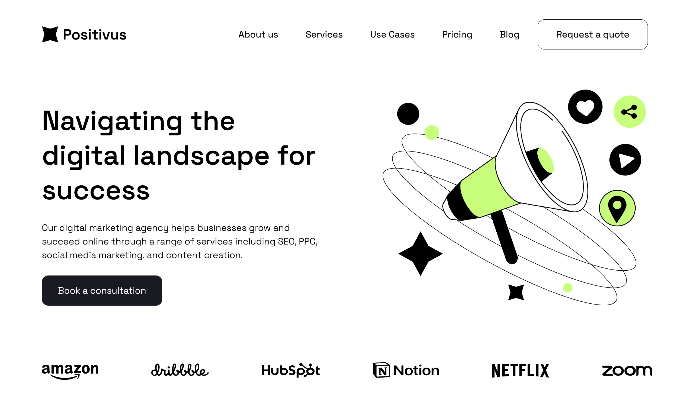

# Positivus Landing Page

A fully responsive landing page for a fictional digital marketing agency, built from the Positivus Figma design using only plain **HTML, CSS and vanilla JavaScript** (no frameworks or libraries).



**Live demo:** <https://jefrex1.github.io/Landing-Page-Positivus/>

## Features

- Pixel-focused recreation of the design, from header to footer
- Fully responsive layout with breakpoints for desktop, tablet and mobile
- Layout built with CSS Grid and Flexbox
- Design tokens (colors) defined as CSS custom properties
- Services cards with hover and press effects
- Working process accordion built on native `<details>` / `<summary>` elements
- Custom testimonials slider: scroll snapping, arrow navigation and dot indicators generated dynamically with JavaScript
- Custom-styled radio buttons and form inputs in the contact section
- Semantic markup and `aria-label` attributes for icon links and buttons

## Tech Stack

- HTML5
- CSS3 (Grid, Flexbox, custom properties, media queries)
- JavaScript (ES6+)
- [Space Grotesk](https://fonts.google.com/specimen/Space+Grotesk) via Google Fonts

## Project Structure

```
├── index.html
├── Positivus.css
├── Positivus.js
└── images/
```

## Getting Started

```bash
git clone https://github.com/Jefrex1/Landing-Page-Positivus.git
cd Landing-Page-Positivus
```

Then open `index.html` in your browser. No build step or dependencies required.

## Notes

This is a front-end only project: the contact and newsletter forms are not connected to a backend.

## Credits

Design: Positivus Figma template.
